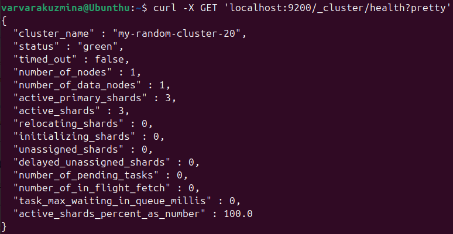
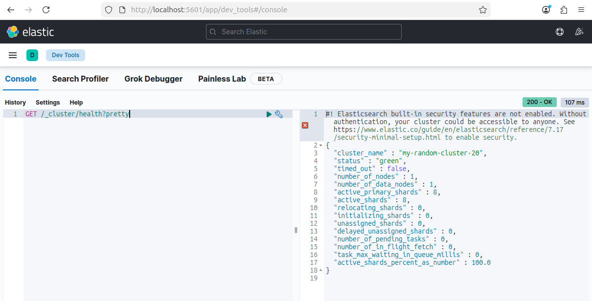
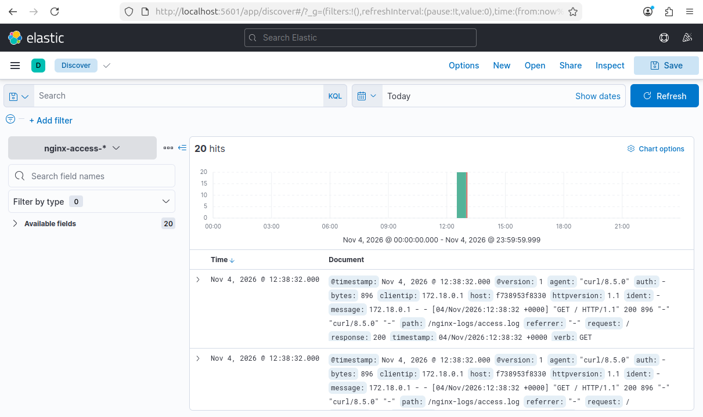
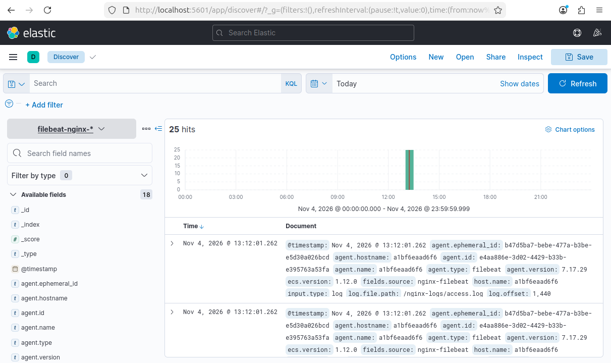

# Домашнее задание к занятию "`ELK" - `Кузьмина Варвара`


---

## Задание 1. Elasticsearch

Установите и запустите Elasticsearch, после чего поменяйте параметр cluster_name на случайный.
Приведите скриншот команды 'curl -X GET 'localhost:9200/_cluster/health?pretty', сделанной на сервере с установленным Elasticsearch. Где будет виден нестандартный cluster_name.

### Решение

Из-за сетевых ограничений (ошибка 403 Forbidden) установка Elasticsearch через официальный APT-репозиторий или прямое скачивание `.deb` пакета были недоступны. Поэтому Elasticsearch версии 7.17.29 был запущен в Docker-контейнере. Для задания имя кластера было изменено на `my-random-cluster-20`.

Скриншот выполнения команды `curl`:



---

## Задание 2. Kibana

Установите и запустите Kibana.
Приведите скриншот интерфейса Kibana на странице http://<ip вашего сервера>:5601/app/dev_tools#/console, где будет выполнен запрос GET /_cluster/health?pretty.

### Решение

Kibana была также запущена в Docker и подключена к Elasticsearch через общую сеть `elastic`. В интерфейсе Dev Tools выполнен запрос `GET /_cluster/health?pretty`, в ответе видно имя кластера `my-random-cluster-20`.

Скриншот интерфейса Kibana:



---

## Задание 3. Logstash

Установите и запустите Logstash и Nginx. С помощью Logstash отправьте access-лог Nginx в Elasticsearch.
Приведите скриншот интерфейса Kibana, на котором видны логи Nginx.

### Решение

Nginx и Logstash были запущены в Docker. Nginx был настроен на запись access-логов в файл (через кастомный конфиг), а Logstash — на чтение этого файла и отправку данных в Elasticsearch в индекс `nginx-access-*`. 
*Примечание: при запуске Logstash в ВМ потребовалось добавить параметр `-Djava.security.egd=file:/dev/urandom` в `LS_JAVA_OPTS` для решения проблемы с нехваткой энтропии.*

В Kibana создан индекс-паттерн `nginx-access-*`, в разделе Discover отображаются логи Nginx.

Скриншот интерфейса Kibana:



---

## Задание 4. Filebeat

Установите и запустите Filebeat. Переключите поставку логов Nginx с Logstash на Filebeat.
Приведите скриншот интерфейса Kibana, на котором видны логи Nginx, которые были отправлены через Filebeat.

### Решение

Поставка логов была переключена на Filebeat (контейнер Logstash остановлен). Filebeat был запущен в Docker с правами `root`, для файла конфигурации были скорректированы права доступа (`chmod go-w`), чтобы удовлетворить требованиям безопасности. В конфигурации был отключен ILM (`setup.ilm.enabled: false`), чтобы логи писались в кастомный индекс `filebeat-nginx-*`.

В Kibana создан новый индекс-паттерн `filebeat-nginx-*`. На скриншоте в Discover видно, что данные успешно поступают, а в полях документа указан агент `filebeat` (поля `agent.type` и `agent.version`).

Скриншот интерфейса Kibana:


```

`При необходимости прикрепитe сюда скриншоты
`
