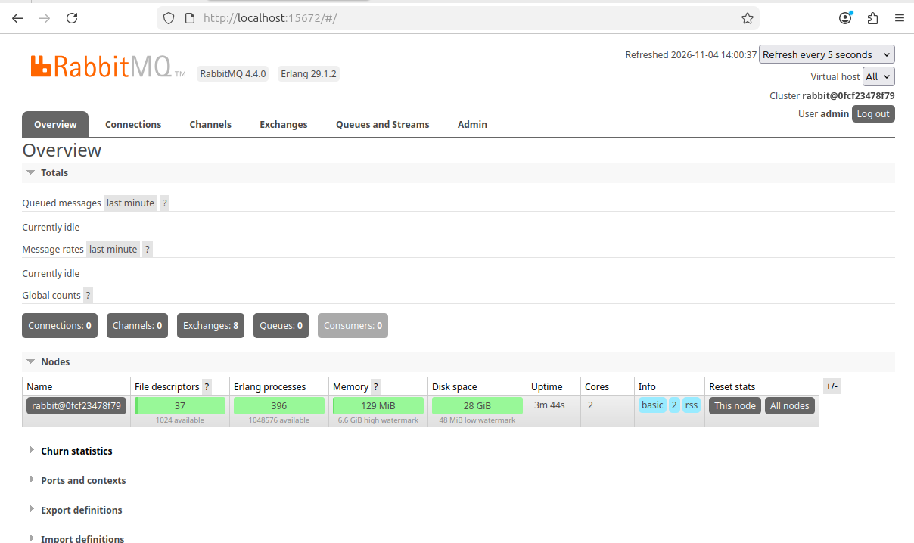
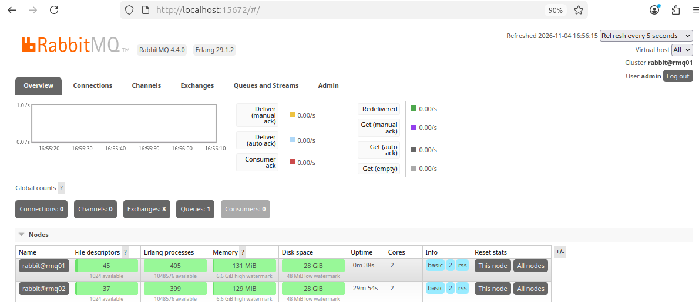
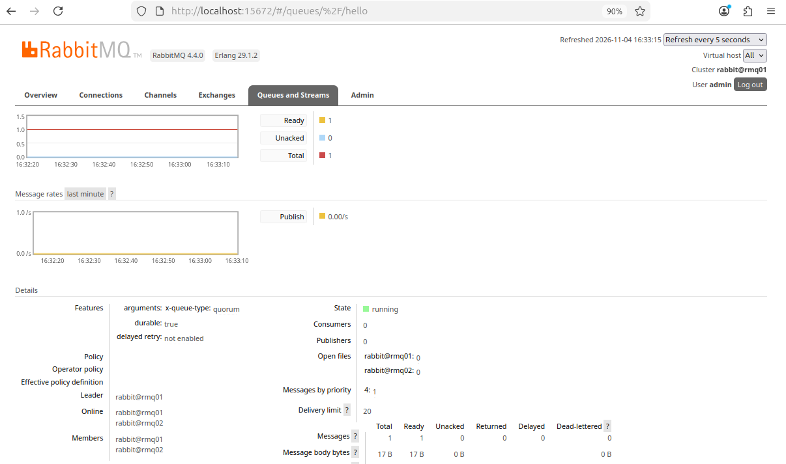
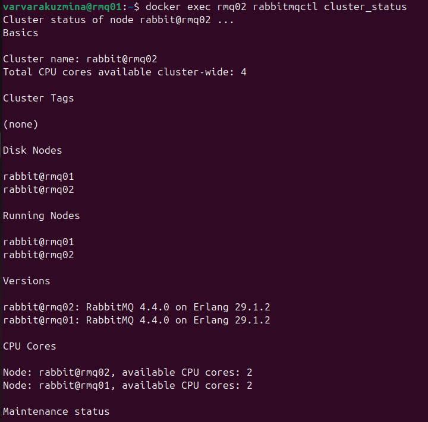
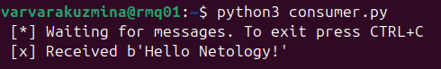

# Домашнее задание к занятию «Очереди RabbitMQ»

**ФИО:** Кузьмина Варвара
**Занятие:** Системы хранения и передачи данных: Очереди RabbitMQ

---

## Задание 1. Установка RabbitMQ

Используя Vagrant или VirtualBox, создайте виртуальную машину и установите RabbitMQ. Добавьте management plug-in и зайдите в веб-интерфейс.
Итогом выполнения домашнего задания будет приложенный скриншот веб-интерфейса RabbitMQ.

### Решение

RabbitMQ был установлен и запущен в Docker-контейнере на виртуальной машине с Ubuntu. Для доступа к веб-интерфейсу использовался образ `rabbitmq:management`, в котором плагин управления уже активирован. Был создан пользователь `admin` с правами администратора для входа в панель управления.

Скриншот веб-интерфейса RabbitMQ:

---

## Задание 2. Отправка и получение сообщений

Используя приложенные скрипты, проведите тестовую отправку и получение сообщения. Для отправки сообщений необходимо запустить скрипт producer.py. Зайдите в веб-интерфейс, найдите очередь под названием hello и сделайте скриншот. После чего запустите второй скрипт consumer.py и сделайте скриншот результата выполнения скрипта.

### Решение

Для работы скриптов был установлен Python 3 и библиотека `pika`. Так как используется RabbitMQ версии 4.x, в скрипты пришлось добавить параметр `durable=True` при объявлении очереди, чтобы избежать ошибки `INTERNAL_ERROR - Feature transient_nonexcl_queues is deprecated`.

Скрипт `producer.py` успешно отправил сообщение, и в веб-интерфейсе появилась очередь `hello` с одним готовым к доставке сообщением:

Скрипт `consumer.py` успешно забрал сообщение из очереди:

---

## Задание 3. Подготовка HA кластера

Создайте вторую виртуальную машину и установите RabbitMQ. Добавьте в файл hosts название и IP-адрес каждой машины. Объедините две машины в кластер и создайте политику ha-all на все очереди. Приложите скриншоты из веб-интерфейса с информацией о доступных нодах в кластере и включённой политикой. Также приложите вывод команды `rabbitmqctl cluster_status` с двух нод. После чего попробуйте отключить одну из нод, поправьте параметры подключения в скрипте consumer.py на вторую ноду и запустите его.

### Решение

Из-за ограничений ресурсов основного ПК (невозможность одновременного запуска двух виртуальных машин) кластер был развернут с помощью двух изолированных Docker-контейнеров (`rmq01` и `rmq02`) на одной виртуальной машине. Контейнеры объединены в общую сеть `rmq-net` и имеют разные имена хостов, что полностью эмулирует работу двух физических нод.

В связи с тем, что в RabbitMQ 4.x классические зеркальные очереди и политика `ha-all` были упразднены, для обеспечения высокой доступности была создана **кворумная очередь (quorum queue)**. Этот тип очереди автоматически реплицируется на все узлы кластера без необходимости создания дополнительных политик.

**1. Скриншот веб-интерфейса с информацией о доступных нодах в кластере:**

**2. Скриншот веб-интерфейса с кворумной очередью (тип `quorum`) и её участниками (Members):**

**3. Вывод команды `rabbitmqctl cluster_status` с двух нод:**

Вывод с ноды `rmq01`:

Вывод с ноды `rmq02`:

**4. Проверка отказоустойчивости:**

Для проверки отказоустойчивости была остановлена нода `rmq01` (`docker stop rmq01`). Из-за особенностей кворумных очередей (требуется большинство узлов для поддержания кворума) при остановке одной из двух нод кворум теряется, и очередь временно становится недоступной для чтения. 

После возврата ноды `rmq01` в строй кворум восстановился, и сообщение было успешно получено через ноду `rmq02` (скрипт `consumer.py` был настроен на подключение к `localhost:5673`), что доказывает сохранность данных и доступность очереди с любой ноды кластера.

